# KoinsMFB

A simple savings app built with Flutter. Users go through onboarding, sign in, set a PIN (and optionally biometrics), browse savings products, create savings plans, and view their dashboard, profile and notifications inbox.

Application id: `com.koins.savings.stephen`

## Setup

Requirements: Flutter 3.32.6 (Dart 3.8.1) and an Android emulator or device.

```bash
git clone git@github.com:Stephen-Odumirin/koins.git
cd koins
flutter pub get
flutter run            # runs on the connected Android device or emulator
flutter test           # runs the test suite
```

### Build

```bash
flutter build apk --debug     # build/app/outputs/flutter-apk/app-debug.apk
flutter build apk --release   # build/app/outputs/flutter-apk/app-release.apk
```

A copy of the release build (about 55 MB) is in `releases/savings-app-release.apk`. **The release build is signed with the debug key** (`android/app/build.gradle.kts` uses `signingConfigs.debug` for `release`), so it installs and runs but is not suitable for a store. See Known gaps.

**Demo credentials:** `test@bank.com` / `Password123`

## Flutter version

- Flutter: **3.32.6** (stable channel)
- Dart: **3.8.1**
- Target: Android, minimum SDK 24 (Android 7.0). iOS folders are scaffolded but not built or tested.

## Packages used

Versions are the resolved versions from `pubspec.lock`.

| Package | Version | Purpose |
|---|---|---|
| flutter_riverpod | 3.3.2 | State management and dependency injection |
| local_auth | 2.3.0 | Optional biometric unlock |
| flutter_secure_storage | 10.3.4 | Keeps the PIN hash and failed-attempt count in secure storage |
| crypto | 3.0.8 | Salted SHA-256 hash of the PIN |
| sqflite | 2.4.2 | SQLite storage for savings plans |
| path | 1.9.1 | Builds the database file path |
| sqflite_common_ffi (dev) | 2.3.6 | Runs SQLite in unit tests on the host machine |
| shared_preferences | 2.5.3 | Logged-in user and the onboarding-complete flag |
| http | 1.6.0 | Calls to the public mock API (`dummyjson.com`) |
| intl | 0.20.2 | Naira currency and date formatting, and localization |
| flutter_svg | 2.2.3 | Renders the brand mark and onboarding illustrations |
| flutter_launcher_icons (dev) | 0.14.4 | Generates the launcher icon |
| cupertino_icons | 1.0.8 | Default Flutter icon set (template) |
| flutter_lints (dev) | 5.0.0 | Lint rules |

Fonts: **Manrope** (SIL Open Font License 1.1), bundled under `assets/fonts/`.

## Features

- Splash with a branded loading animation, then onboarding (three illustrated slides, shown once), then login
- Login with validation (email required, valid format, password required, minimum 8 characters), using the demo credentials above
- PIN setup after the first login (4 digits), then an optional biometric offer
- Lock on cold start and on resume; three wrong PIN attempts sign the user out
- Dashboard: greeting, total savings (the sum of saved amounts) with a hide/show eye control, quick actions, the three most recent savings with "See all", and progress rings
- Savings products: searchable list with a "Flexible only" filter; a details page with a Create savings button that pre-selects the product
- Create savings as a stepper: target, monthly amount and months always tally (target = monthly × months), and the amounts are formatted in naira as you type. Ends with a success step
- Saved plan details: the progress ring is saved ÷ target, the same rule as the dashboard
- Profile loaded from `dummyjson.com`, with logout back to login
- Mock notifications inbox, opened from the profile screen
- Pull to refresh on the dashboard and products list
- Loading, empty and error states, with retry where it makes sense
- Motion is off when the system asks for reduced motion

## Design

- **Tokens** in `lib/core/theme/`: `AppColors` (primary `#5FA332`, brand `#81CB50`, white surface, heading `#15181B`, body `#5C6470`, outline `#E4EADB`, accent `#F2A93B`, dark surface `#14190F`, dark card `#1E2516`), `AppSpacing` (radii: 12 for fields, 14 for buttons, 16 for cards, 10 for chips), and `AppTheme` (light and dark). Manrope with a Roboto / Noto Sans fallback, because Manrope has no Naira sign.
- **Adaptive PIN pad** (`lib/widgets/pin/adaptive_pin_pad.dart`): key size scales with the screen, clamped to 56–88.
- **Brand loader** (`lib/widgets/brand_loader.dart`): a `CustomPainter` drawing the KoinsMFB mark; static under reduced motion.
- **Onboarding illustrations**: original line art in `assets/onboarding/illustration_1.svg` to `_3.svg`.
- **Localization**: every user-visible string is in `lib/l10n/app_en.arb`.

## Architecture

Layered: screens, then providers, then repositories, then services. Models are plain Dart with no Flutter imports. See [`docs/ARCHITECTURE.md`](docs/ARCHITECTURE.md) for the write-up.

**State management: Riverpod.** Providers are typed and resolved at compile time, so a missing dependency fails early. Tests replace any provider with `ProviderScope(overrides: [...])`, so widget tests never touch the network, disk or secure storage. One state package covers state, dependency injection and async loading.

**Navigation: `Navigator` with named routes.** The lock screen is a route on the app navigator (`appNavigatorKey`), not an overlay, so Back is handled by the lock screen's `PopScope` and never reveals the screen beneath it.

**Local storage**

- **SQLite (`sqflite`)** for savings plans, in a `plans` table (database version 2). The table is seeded in code with three plans whose saved amounts total ₦850,000.
- **SharedPreferences** for small flags: the logged-in email and the onboarding-complete flag.
- **flutter_secure_storage** for the PIN hash and the failed-attempt count.
- **Why no Hive:** SQLite is already needed for structured plan data, is queryable, and needs no code generation or adapters.

## Assumptions

- Sign-in is demo only. Register and Forgot Password are visible but non-functional, as the brief requires (they show "Coming soon").
- Biometrics are optional. The user is offered them after setting a PIN and can always unlock with the PIN.
- The PIN is 4 digits.
- Android is the target. iOS is not built or tested.
- The Koins asset bundle (icon and logo) is provided by the owner.
- The product list is static seed data. Search runs on that list.
- The dashboard total is the sum of saved amounts. The three seeded plans give ₦850,000. A new plan starts with its opening deposit saved (default 0), because the app has no other deposit records.
- Progress rings show the saved amount as a share of the target.
- The profile screen uses `dummyjson.com/users/1` as the logged-in user's data.
- The greeting uses the demo name, "John Doe", as the brief specifies.
- Amounts are whole naira. Commas are accepted and removed before parsing.

## Testing

```bash
flutter test
flutter analyze lib test
```

Covers validators, formatters, storage (including corrupt-data recovery and the seeded plans table), auth, PIN and lock logic, savings and product providers, notifications, the user API service (success, HTTP error, offline, timeout, malformed body), and widget tests for the main screens.

Run both commands for the current result. Integration tests run on a device and are not part of `flutter test`.

## Screenshots

Captured on an Android emulator, in `screenshots/`. The walk-through set is in order of the flow.

### Onboarding and sign-in

| | | |
|---|---|---|
| 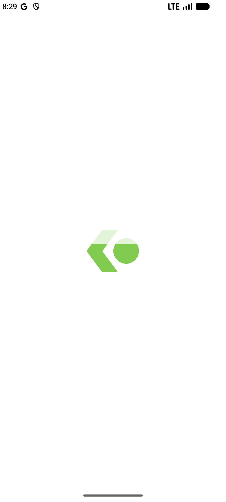 | 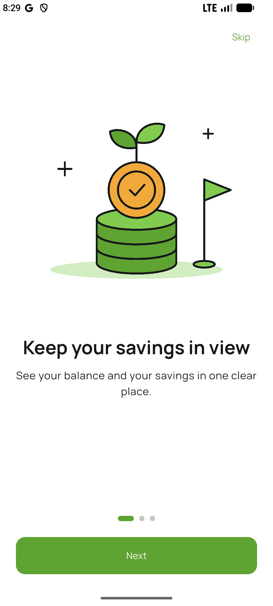 | 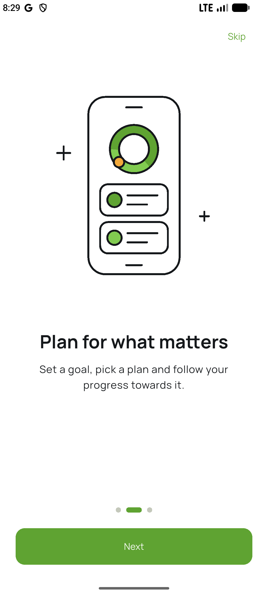 |
| Splash | Onboarding slide 1 | Onboarding slide 2 |
| 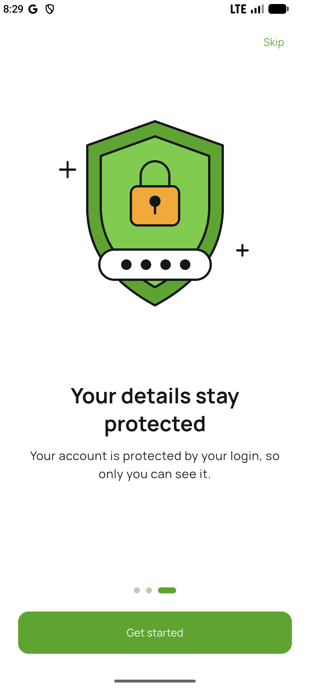 | 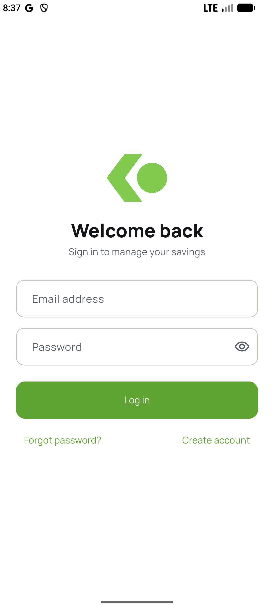 | 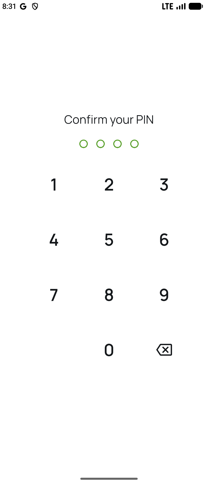 |
| Onboarding slide 3 | Login | PIN setup |
| 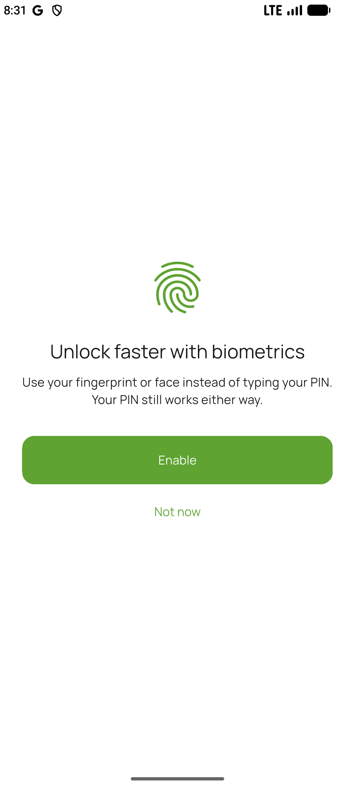 | 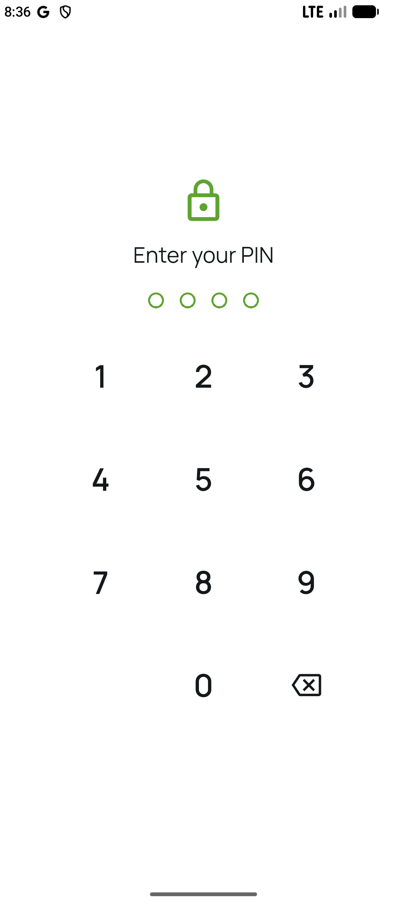 | |
| Biometric offer | Lock screen | |

### Dashboard and savings

| | | |
|---|---|---|
| 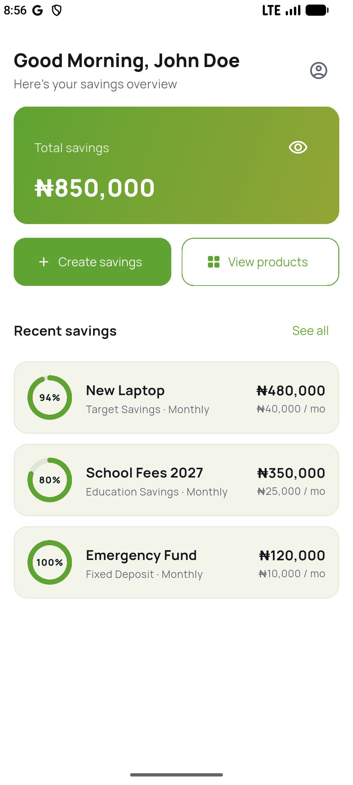 | 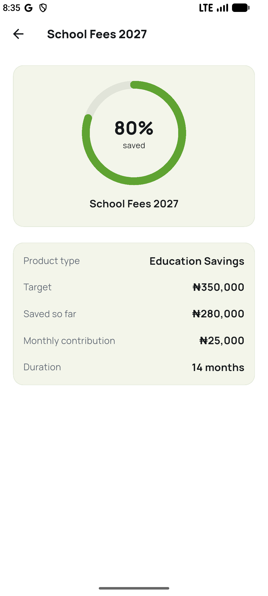 | 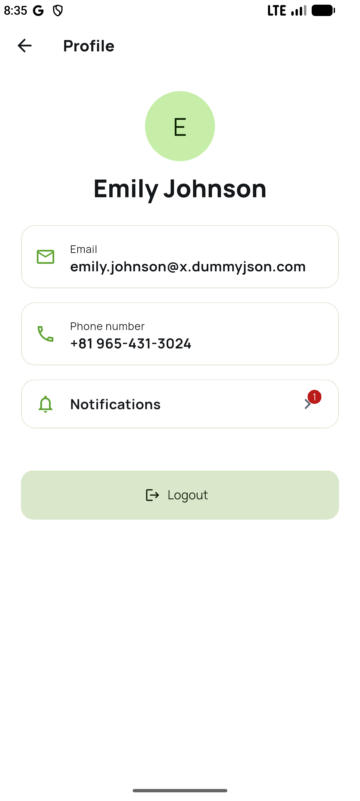 |
| Dashboard with the total | Saved plan details | Profile |
| 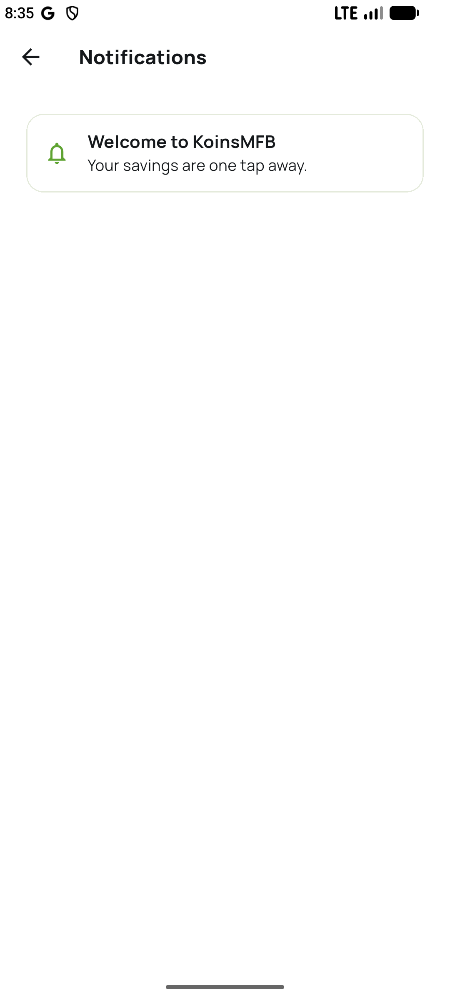 | | |
| Notifications inbox | | |

### Products and create savings

| | | |
|---|---|---|
| 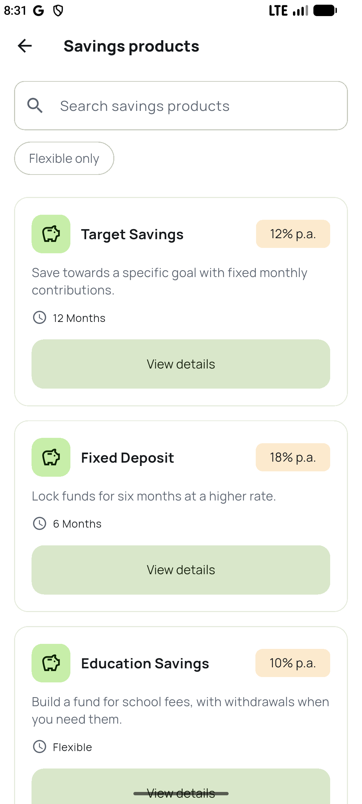 | 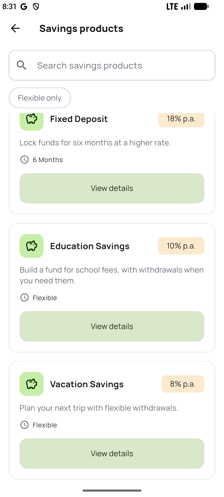 | 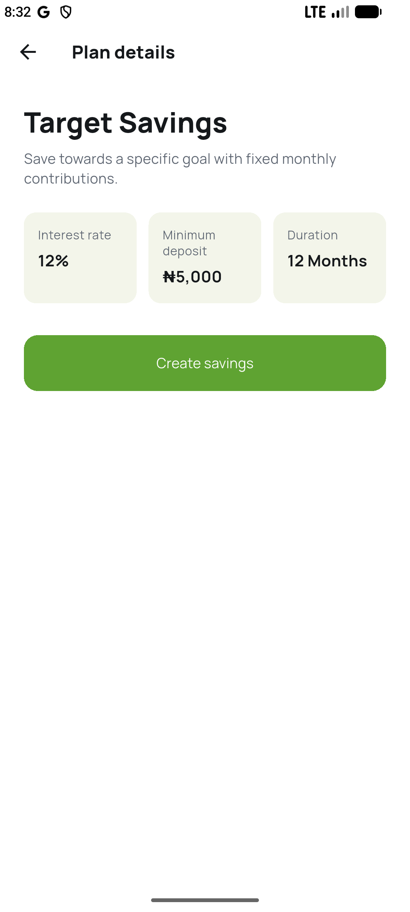 |
| Products | Products, more | Product details |
| 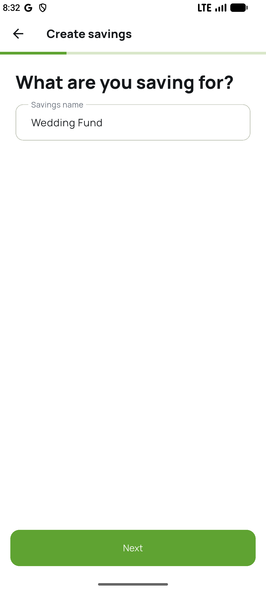 | 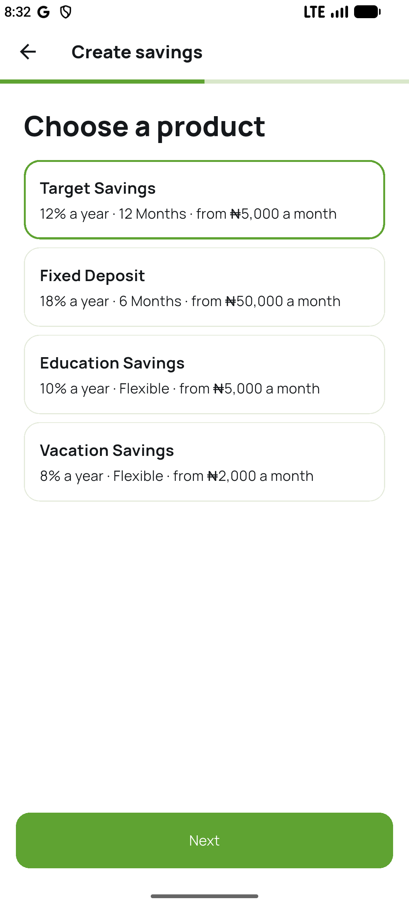 | 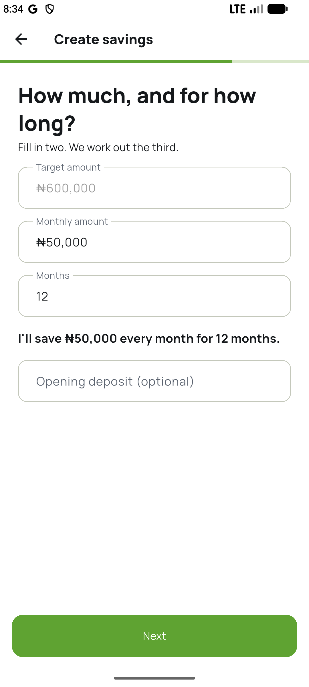 |
| Create savings: name | Create savings: product | Create savings: amounts |
| 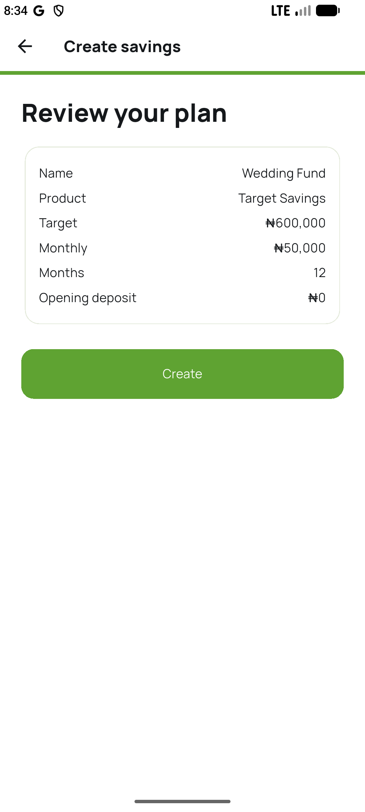 | 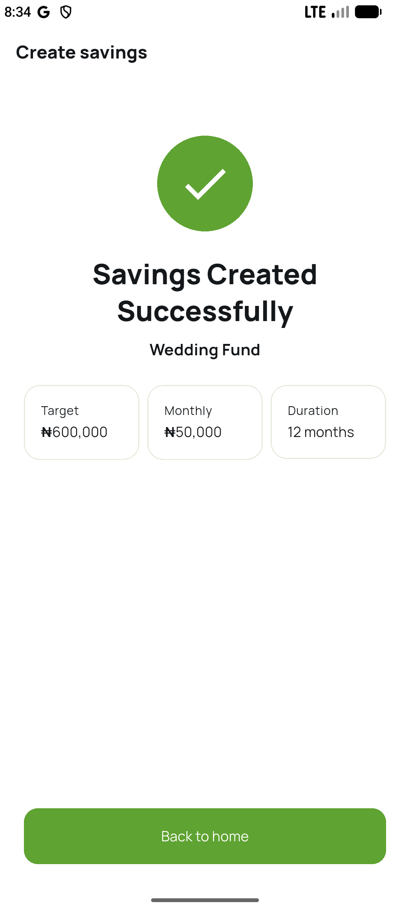 | |
| Create savings: review | Create savings: success | |

## Known gaps

- The release APK is signed with the debug key, so it isn't suitable for the Play Store.
- The Naira sign uses a fallback font (Roboto / Noto Sans), because Manrope has no glyph for it.

## Improvements if given more time

- Real backend and authentication, with tokens in secure storage.
- Real registration and password reset.
- Firebase Analytics and real push notifications. Both are not started: they need FlutterFire configuration, and push is still the mock inbox.
- PBKDF2 (or another slow hash) for the PIN, instead of a salted SHA-256.
- A proper release signing key, for the Play Store.
- iOS build and testing.
- A test-user screen for reviewers.
- More widget tests, and integration tests run on a device in CI.
- Track real deposits, so saved amounts come from payments instead of seed data.
- Offline detection and a global offline banner.
- An accessibility audit.
